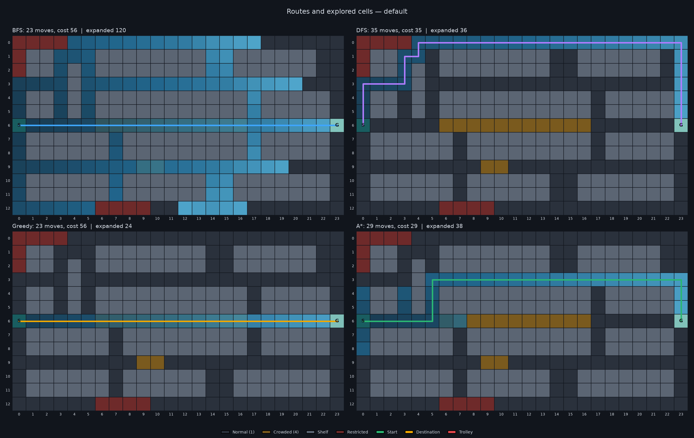
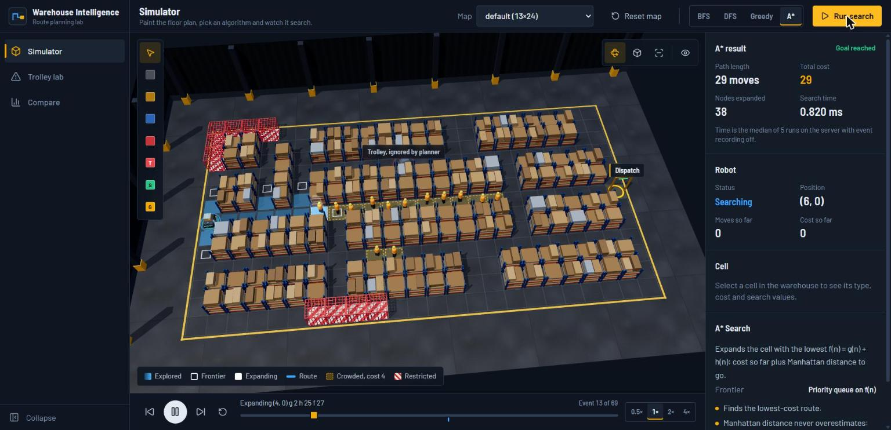
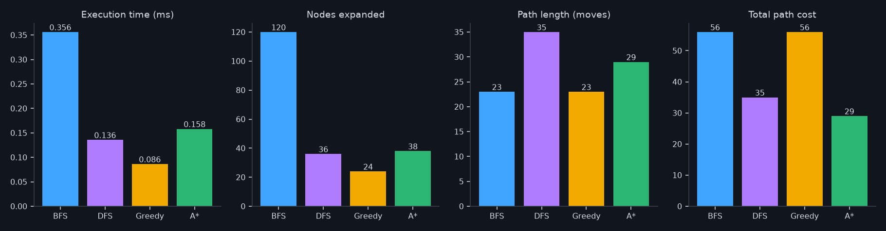
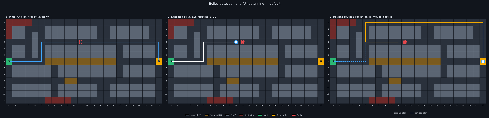
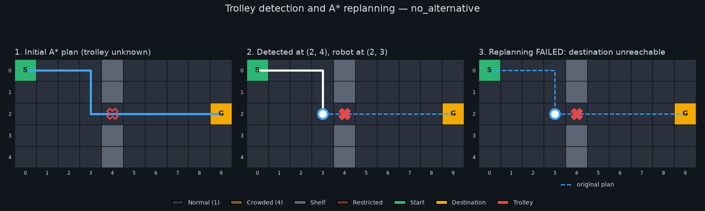

# AI-Based Route Planning for a Warehouse Delivery Robot

Artificial Intelligence – Group Coding Assignment · Group <!-- FILL IN: XX -->

**Live demo:** https://warehouse-intelligence.onrender.com (free instance: the first visit after a quiet spell can take about a minute to wake up)

[](https://render.com/deploy?repo=https://github.com/asminity/warehouse-intelligence)

A simulated delivery robot plans routes on a 2D warehouse grid with **Breadth-First Search, Depth-First
Search, Greedy Best-First Search and A\***. It handles **weighted movement costs**. It also **detects an
unexpected trolley** on its planned route and **replans with A\* from its current position**.

---

## 1. Problem statement

A warehouse robot carries packages from a packing station to a dispatch area. Shelves and restricted
zones block some routes, and crowded aisles take longer to cross. A trolley may block a route that the
robot believes is clear. We search for routes with four algorithms and compare them. We also show how
the robot reacts when it discovers an obstacle on its plan.

## 2. Quick start

Requires Python 3.10+.

```bash
pip install -r requirements.txt

python main.py                          # default warehouse: grid, 4 routes, table, trolley demo
python main.py --list                   # list scenarios
python main.py --scenario short_vs_cheap
python main.py --scenario no_alternative   # trolley with no alternative route -> failure report
python main.py --trolley 9,12           # add your own (unknown) trolley at row 9, col 12
python main.py --sensor-range 3         # robot sees 3 cells ahead instead of 1
python main.py --save-figures --csv     # write PNGs to screenshots/ and a CSV to results/
python main.py --animate astar          # animate exploration + robot (bfs | dfs | greedy | astar)
python main.py --animate trolley        # animate detection and replanning

python -m pytest                        # run the test suite
```

### Optional: 3D web viewer

There is an interactive 3D warehouse in the browser for presenting the project. It is a viewer only: every
route, cost, explored cell and replanning decision comes from the same Python package, through a small
FastAPI wrapper (`server/app.py`). The browser replays the events Python returns.

```bash
pip install -r requirements.txt               # includes fastapi + uvicorn

# One command (uses the pre-built frontend in web/dist):
uvicorn server.app:app --port 8000            # then open http://localhost:8000

# Or develop the frontend (needs Node 20+):
uvicorn server.app:app --port 8000            # terminal 1: API
cd web && npm install && npm run dev          # terminal 2: open http://localhost:5173
```

| View | What it shows |
|---|---|
| **Simulator** | Paint the floor (normal, crowded, shelf, restricted, trolley, start, destination). Run one algorithm and replay its expansions, frontier and route, then watch the robot drive it. Click a cell to read its type, cost and, for A\*, its `g`, `h` and `f` values |
| **Trolley lab** | The full Task 4 sequence: plan, detect the trolley before entering it, update the map, replan from the current cell, resume or report the destination unreachable. Sensor range is adjustable, and you can place your own trolleys |
| **Compare** | All four algorithms on separate copies of one map: routes side by side on the floor, the comparison table, four charts, the generated findings, and a CSV export |

Controls: drag to orbit, right-drag to pan, scroll to zoom. Keyboard: `Space` play/pause, `←`/`→` step,
`R` replay, `8`/`9`/`0` perspective/isometric/top view, `L` lower the racks, `V` and `1`–`7` editing tools.

Maps are plain text files in `scenarios/`, so you can edit them or add new ones:

| Symbol | Cell | Passable | Cost to enter |
|---|---|---|---|
| `.` | Normal aisle | yes | 1 |
| `~` | Crowded aisle | yes | 4 |
| `#` | Shelf | no | – |
| `X` | Restricted zone | no | – |
| `S` | Start (packing station) | yes | 1 |
| `G` | Destination (dispatch) | yes | 1 |
| `T` | Trolley: physically present, **unknown to the robot** at first | no | – |

| Scenario | Purpose |
|---|---|
| `default` | Main demo: crowded main aisle, quieter detours, trolley on the initial A\* route |
| `short_vs_cheap` | Minimal Task 3 case: 3-move crowded route vs 7-move clear route |
| `open` | Open floor; all algorithms behave alike |
| `complex` | Dead ends, restricted zones and scattered congestion |
| `congested` | Most aisles crowded; only the perimeter is clear |
| `blocked_destination` | Destination sealed off; every algorithm must report "no route" |
| `no_alternative` | Trolley blocks the only crossing; replanning must fail |

## 3. Problem formulation (Task 2)

| Component | Definition |
|---|---|
| **State** | The robot's cell `(row, col)` |
| **Initial state** | The START cell, or the robot's current cell when it replans |
| **Actions** | `UP, RIGHT, DOWN, LEFT`, always generated in this order. An action is legal if the target cell is inside the grid and passable on the robot's *known* map |
| **Transition model** | `RESULT((r,c), UP) = (r−1, c)`, `RIGHT → (r, c+1)`, `DOWN → (r+1, c)`, `LEFT → (r, c−1)` |
| **Goal test** | `state == DESTINATION` |
| **Path cost** | Sum of the costs of entering each cell after the first: normal = 1, crowded = 4 |

The code is in `warehouse/problem.py`. Every algorithm uses the same `SearchProblem`. Every route cost
comes from one shared function, `warehouse/path_cost.py`, which also rejects illegal paths.

## 4. Algorithms (Task 3)

| Algorithm | Frontier | Order of expansion | Guarantees on this grid |
|---|---|---|---|
| **BFS** | FIFO queue | Level by level | Fewest **moves**. *Not* lowest cost when costs differ |
| **DFS** | LIFO stack (iterative) | Deepest first | Finds *a* route if one exists. Neither shortest nor cheapest |
| **Greedy Best-First** | Priority queue on `h(n)` | Looks closest to the goal | Finds a route if one exists. Not shortest, not cheapest |
| **A\*** | Priority queue on `f(n) = g(n) + h(n)` | Lowest estimated total cost | **Lowest total cost** (optimal) |

Implementation details:

- **Same rules for all four algorithms:**
  - The goal test is applied when a node is *expanded*, so `nodes_expanded` means the same thing for
    every algorithm.
  - Neighbours are always generated in the order UP, RIGHT, DOWN, LEFT.
  - Priority-queue ties are broken by insertion order, so every run is reproducible.
- **DFS** uses an explicit stack, not recursion, so it cannot hit Python's recursion limit. A cell is
  marked visited when it is popped. Neighbours are pushed in reverse order so they are explored in
  UP, RIGHT, DOWN, LEFT order.
- **A\*:**
  - It stores the cheapest known `g` for each cell and re-pushes a cell only when it finds a strictly
    cheaper `g`.
  - Outdated heap entries are skipped when they are popped.
  - Ties on `f` go to the smaller `h`.
  - With tracing on, every expansion records `g`, `h` and `f`.
- **Timing:** `execution_time_ms` is the median of 5 runs with event tracing switched off. A separate
  traced run records the exploration order used for the figures.

### Manhattan distance is a lower bound (admissible)

`h(n) = |row_n − row_goal| + |col_n − col_goal|`

The robot moves only up, down, left and right, so each move changes the Manhattan distance by at most 1.
Reaching the goal therefore takes **at least `h(n)` moves**. Every move costs **at least 1** (normal = 1,
crowded = 4), so the true remaining cost is at least `h(n)`. The heuristic never overestimates.

It is also **consistent**. For any move from `n` to `n'` with cost `c ≥ 1`, `|h(n) − h(n')| = 1 ≤ c`, so
`h(n) ≤ c(n,n') + h(n')`. As a result, the first time A\* expands a cell it already has that cell's
cheapest cost. This is why A\* can close cells and still return the optimal route.

### Why BFS can find fewer moves while A\* finds a lower cost

BFS counts moves and ignores what each move costs. When the direct route crosses crowded cells
(4 each), BFS still takes it because it has the fewest moves. A\* weighs actual cost. It will take a
longer detour through normal cells when the detour is cheaper overall. The *shortest* route and the
*cheapest* route are different things.

## 5. Obstacle detection and replanning (Task 4)

The code is in `warehouse/simulation/replanning.py`.

1. The program keeps two maps:
   - the **ground truth**, which includes the trolley;
   - the robot's **known map**, which starts with the trolley *removed*.
2. The robot plans with A\* on its known map and follows the route one cell at a time.
3. Before **every** move, its sensor checks the next cell of the plan against the ground truth.
   (`--sensor-range N` makes it look N cells ahead.)
4. When it detects the trolley, the robot **stops before entering the cell** and marks the cell
   impassable on its known map. It then runs **A\* again from its current position** to the same
   destination.
5. If a new route exists, the robot continues on it. Otherwise it stays stopped and reports that the
   destination is **unreachable**. No route is invented.
6. The loop repeats, so a second trolley causes a second replan. The **number of replans** is
   recorded.

The simulation produces this event sequence: `INITIAL_PLAN → ROBOT_MOVED… → OBSTACLE_DETECTED →
ROBOT_STOPPED → MAP_UPDATED → REPLANNING_STARTED → NEW_PATH_FOUND | REPLANNING_FAILED → ROBOT_RESUMED →
… → DELIVERY_COMPLETED`.

## 6. Results (Task 5)

All numbers below were copied from real runs of `python main.py` on our machine (Windows 11,
Python 3.14). The route lengths, costs and node counts are deterministic. Times are in milliseconds,
vary slightly between machines and runs, and are too small to rank the algorithms reliably.

### Default warehouse (`python main.py`)

| Algorithm | Goal reached | Moves | Total cost | Nodes expanded | Time (ms) |
|---|---|---|---|---|---|
| BFS | Yes | 23 | 56 | 120 | 0.356 |
| DFS | Yes | 35 | 35 | 36 | 0.136 |
| Greedy | Yes | 23 | 56 | 24 | 0.086 |
| A\* | Yes | 29 | 29 | 38 | 0.158 |

**Findings** (generated by the program from these numbers):

- **Fewest moves:** BFS and Greedy, 23 moves. Both take the straight main aisle, which crosses 11
  crowded cells.
- **Lowest cost:** A\*, cost 29. It takes the northern aisle: 6 more moves, but **27 cheaper**.
- **The shortest route was not the cheapest.**
- **Fewest nodes expanded:** Greedy (24). It ran straight at the goal, which happened to work but cost
  almost twice as much.
- **DFS:** it found an even longer route (35 moves, cost 35) by wandering along the top wall.





### Trolley experiment (default warehouse)

- The trolley is at **(3, 11)**. It lies on the original A\* route but is absent from the robot's map.
- At step 13 the robot is at **(3, 10)** and detects the trolley one cell ahead. It stops, updates its
  map, and replans with A\* from (3, 10).
- The revised route goes back to the vertical aisle and along the top row: 32 moves, cost 32,
  42 nodes expanded.

| Experiment | Goal reached | Moves | Total cost | Nodes expanded (all plans) | Replans |
|---|---|---|---|---|---|
| A\* with replanning | Yes | 45 | 45 | 80 | 1 |



### Short crowded route vs long cheap route (`--scenario short_vs_cheap`)

```
S ~ ~ G      BFS: S→~→~→G            3 moves, cost 4+4+1 = 9
. # # .      A* : around the shelf   7 moves, cost 7
. . . .
```

| Algorithm | Goal reached | Moves | Total cost | Nodes expanded | Time (ms) |
|---|---|---|---|---|---|
| BFS | Yes | 3 | 9 | 6 | 0.019 |
| DFS | Yes | 3 | 9 | 4 | 0.012 |
| Greedy | Yes | 3 | 9 | 4 | 0.013 |
| A\* | Yes | 7 | 7 | 9 | 0.032 |

### Replanning fails: no alternative route (`--scenario no_alternative`)

The trolley blocks the only gap in a shelf wall. The robot detects it at (2, 4) while standing at
(2, 3), replans, finds no route, stops, and reports *"Destination (2, 9) is unreachable"*.

| Experiment | Goal reached | Moves | Total cost | Nodes expanded (all plans) | Replans |
|---|---|---|---|---|---|
| A\* with replanning | No | – | – | 32 | 1 |



### Complex warehouse (`--scenario complex`)

| Algorithm | Goal reached | Moves | Total cost | Nodes expanded | Time (ms) |
|---|---|---|---|---|---|
| BFS | Yes | 44 | 56 | 137 | 0.564 |
| DFS | Yes | 46 | 49 | 47 | 0.232 |
| Greedy | Yes | 52 | 52 | 82 | 0.372 |
| A\* | Yes | 46 | 49 | 123 | 0.598 |

Here DFS happened to find a route as cheap as A\*'s. That is luck from the neighbour order, not a
guarantee: on the default map DFS costs 35 against A\*'s 29.

## 7. Testing

`python -m pytest` runs **129 tests**. All pass. They cover:

- **The mandatory scenarios:**
  - open warehouse, shelves, restricted zones, crowded cells changing the route;
  - short-crowded vs long-cheap;
  - no route, start = destination, invalid start/destination, malformed maps.
- **The trolley:**
  - it lies on the initial A\* route and is missing from the known map;
  - the robot replans from its **current** position;
  - the robot **never enters** the trolley cell or any impassable cell;
  - replanning succeeds when it should and is reported as failed when there is no alternative;
  - a second trolley triggers a second replan.
- **Shared invariants:**
  - every path is 4-connected and avoids impassable cells;
  - every reported cost equals `path_cost(path)`;
  - results are deterministic.
- **The web API:** scenarios, a search returning the real event trace (A\* `f = g + h` on every expansion),
  the comparison, the trolley demo, and clean 4xx errors with no stack traces for invalid input.
- **A Dijkstra check on 50 random grids**, using an independent uniform-cost search:
  - A\*'s cost always equals the optimum;
  - BFS's move count always equals the minimum number of moves;
  - DFS and Greedy always return valid routes that are never cheaper than optimal.

## 8. Project structure

```
main.py                         command-line program (Tasks 1, 3, 4, 5 output)
warehouse/
  grid.py                       cell types, costs, map parsing/validation, known-map view
  problem.py                    SearchProblem: state, actions, transition, goal test, step cost
  heuristic.py                  Manhattan distance (+ admissibility/consistency notes)
  path_cost.py                  single shared path-cost + path validation
  result.py                     SearchResult dataclass, event types, path reconstruction
  algorithms/bfs.py dfs.py greedy.py astar.py
  simulation/replanning.py      ground truth vs known map, sensor, A* replanning loop
  compare.py                    run all four, timing, comparison table, generated findings, CSV
  render/ascii.py               labeled console grid with route overlay
  render/plots.py               Matplotlib figures and animations
server/app.py, schemas.py       FastAPI wrapper (no algorithm code): REST endpoints, validation, serves web/dist
web/src/three/                  React Three Fiber scene: building, instanced racks, zones, robot, trolley, overlays
web/src/lib/timeline.ts         turns backend events into a replayable timeline (no route logic)
web/src/components/, App.tsx    UI shell: sidebar, top bar, inspector panels, timeline, comparison table and charts
scenarios/*.txt                 warehouse maps
tests/                          pytest suite (incl. Dijkstra check)
screenshots/                    figures generated by --save-figures
results/                        CSV tables and saved console output
```

```
 scenarios/*.txt ──► Grid ──► SearchProblem ──► BFS | DFS | Greedy | A*  ──► SearchResult
                      │                                                       │
                      └─ known_view() ──► replanning loop (sense → update → A*) ┤
                                                                               ▼
                                     compare.py (table, findings, CSV) ─► render (console / PNG / animation)
```

## 9. Team and contributions

<!-- FILL IN: real names, roll numbers and what each member did -->

| # | Name | Roll number | Contribution |
|---|---|---|---|
| 1 | | | Warehouse grid and search-problem formulation (`grid.py`, `problem.py`) |
| 2 | | | BFS and DFS (`algorithms/bfs.py`, `algorithms/dfs.py`) |
| 3 | | | Greedy Best-First Search and heuristic explanation (`greedy.py`, `heuristic.py`) |
| 4 | | | A\* and weighted path costs (`astar.py`, `path_cost.py`) |
| 5 | | | Trolley detection, map update and replanning (`simulation/replanning.py`) |
| 6 | | | Testing, visualisation, performance comparison and documentation |

Group representative: <!-- FILL IN: name, email, phone -->

## 10. Acknowledgements

- Algorithms follow the standard descriptions in Russell & Norvig, *Artificial Intelligence: A Modern
  Approach* (4th ed.), chapter 3.
- Libraries: NumPy, Matplotlib, pytest; web viewer: FastAPI, React, Three.js, React Three Fiber, drei,
  Tailwind CSS, Recharts, Zustand, lucide-react. Fonts: Barlow (Google Fonts).
- <!-- FILL IN: acknowledge any AI assistants or other external code you used, as the brief requires. -->
